<div align="center">


# LotusNotch

**A notch for Windows.** Your tools, your clipboard, your dock and a ring of file
actions, in one small app that stays out of your way.

[](https://github.com/IAMUCN/bloom-enhanced/releases/latest)
[](LICENSE)
[](#install)
[](#how-its-built)
[](https://github.com/IAMUCN/bloom-enhanced/releases/latest)

[**Download**](https://github.com/IAMUCN/bloom-enhanced/releases/latest) ·
[Features](#what-you-get) ·
[Help wanted](#help-wanted-ram-and-uiux) ·
[Build it](#build-from-source) ·
[Settings reference](SETTINGS.md)

<br />

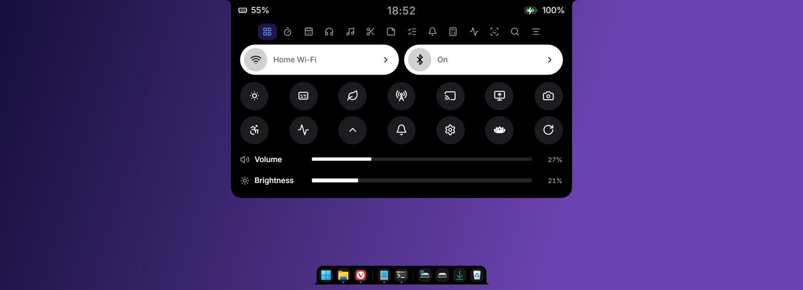

</div>

> **Status: pre-1.0, built in the open.** Things change between versions and
> some edges are rough. 1.0 is the first release meant for everyone. Bug
> reports and ideas are very welcome.

---

## Why LotusNotch exists

Windows is great at running apps and poor at the small things around them:
the quick note, the timer, the thing you copied ten minutes ago, converting a
file without opening three programs, turning Wi-Fi off without digging through
a flyout. People end up with a dozen tiny utilities, each with its own tray
icon and its own memory bill.

LotusNotch puts those small things in one place, in the spirit of a phone's
dynamic island:

- **One glanceable surface** at the top of the screen. Rest the pointer on it
  and it opens; move away and it gets out of the way.
- **Everything is a module.** Notch, dock, shelf and radial menu each work on
  their own. Use the notch without the dock, the shelf without the notch, or
  the radial menu with nothing else at all.
- **Local and private.** Your clipboard history, notes and settings stay on
  your PC. Sharing between your own PCs is peer to peer and encrypted.
- **Light.** A Rust core talking straight to Windows, small pages that load
  only when you use them, and an installer of about 8 MB. See
  [Light on your PC](#light-on-your-pc) for the real numbers, and where help
  is wanted.

It began as a fork of [Bloom](https://github.com/SehajveerSingh2005/bloom) and
grew its own shelf, radial menu, tools, sharing and settings. See
[Credits](#credits).

---

## What you get

### The Notch

A pill at the top of your screen: the time, battery and the numbers you pick
beside it. Rest on it and it opens into a row of tabs. Scroll on the clock, or
press **1 to 9**, to move between them.

<table>
<tr>
<td width="50%">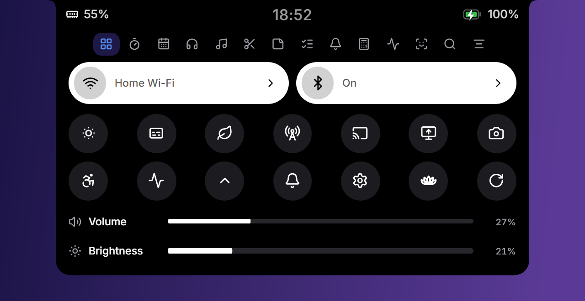</td>
<td width="50%">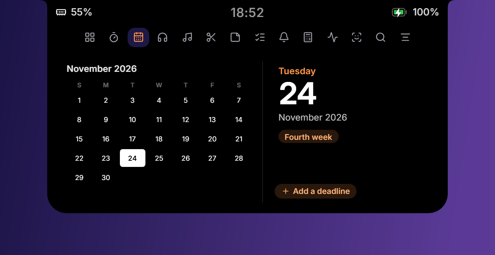</td>
</tr>
<tr>
<td align="center"><b>Command Center.</b> Wi-Fi, Bluetooth, night light, hotspot, cast, accessibility, volume and brightness. The tiles are yours to pick and order, and their colour adapts to your accent.</td>
<td align="center"><b>Calendar.</b> A month view with deadlines you can count down to.</td>
</tr>
<tr>
<td>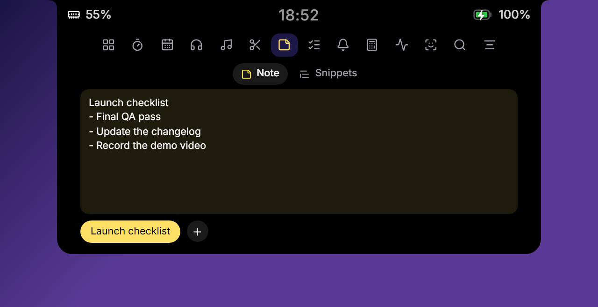</td>
<td>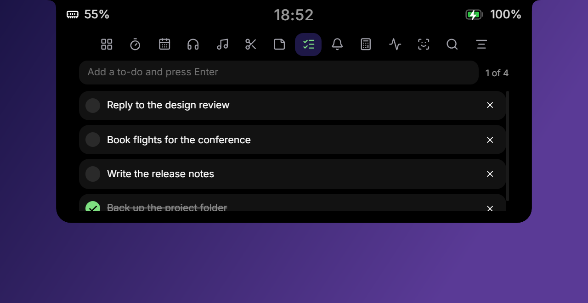</td>
</tr>
<tr>
<td align="center"><b>Notes and snippets.</b> Notes that save themselves, and saved text you type often, one click to copy.</td>
<td align="center"><b>To-dos.</b> Tick things off; finished ones sink to the bottom.</td>
</tr>
<tr>
<td>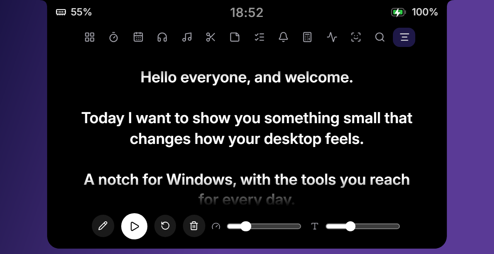</td>
<td>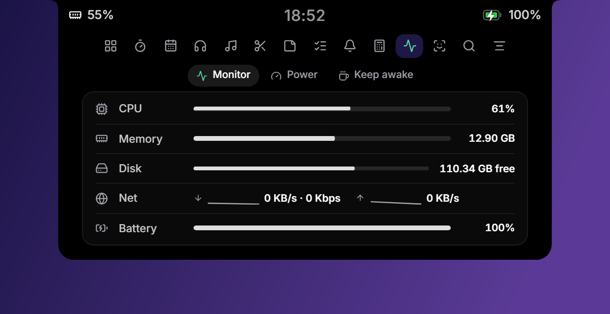</td>
</tr>
<tr>
<td align="center"><b>Teleprompter.</b> Your script scrolls right under the camera, hidden from screen shares and recordings. Scroll the wheel to go back a line.</td>
<td align="center"><b>System.</b> CPU, memory, disk, network and battery at a glance, plus Windows power modes and Keep awake.</td>
</tr>
</table>

**More tools, each loaded only while it is switched on:** timer, stopwatch and
Pomodoro, reminders, deadlines, calculator, unit converter, screenshot and
screen recording, OCR (read the text in a snip), colour picker, camera mirror,
emoji, app launcher and app sets, game strip, music with a live visualizer, and
connected devices. Pick the ones you want on first run, and change them any
time in Settings.

Notch size, open size, mode (always visible, peek on hover, or smart hide when
an app covers the screen), which display it sits on, and the light that runs
along its edge are all settings, with live previews.

<p align="center"></p>

### The Dock

A dock in place of the Windows taskbar. Drag to reorder, hover for window
previews, right-click for menus, and `Win` + a number still launches or
switches. Drives, folders and the Recycle Bin can sit beside your apps. Fixed,
peek or smart modes, icon-only look, and an adaptive stretch when a window is
maximized.

<p align="center"></p>

### The Shelf

Everything you copy (text, links, images, files) is kept on this PC, one click
away.

<table>
<tr>
<td width="300">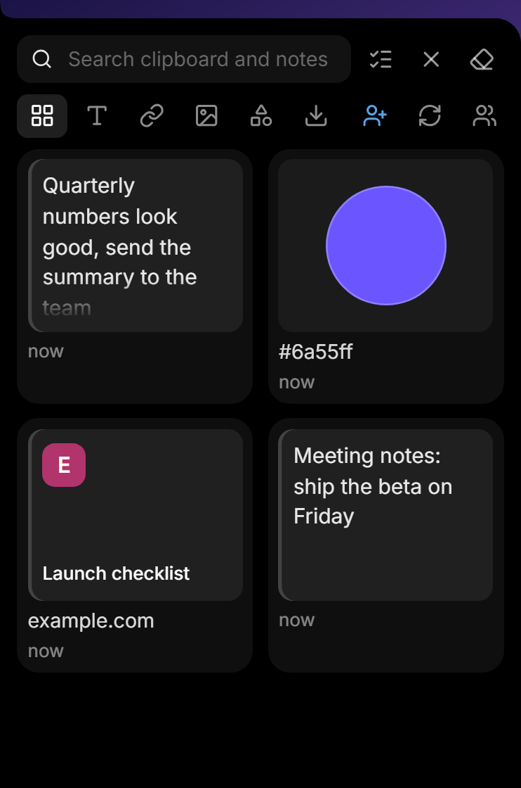</td>
<td valign="top">

- Lives in the notch, or slides out of the middle of the left, right or top
  edge of the screen.
- Drag anything onto it to keep it. Drag it back out into any app.
- Pin, search, filter by type, select several, add notes. Short text gets big
  tiles, long text wide ones, links get a preview.
- **Share with people near you.** Pair two PCs once and send text, links and
  files over your Wi-Fi: peer to peer, encrypted, nothing goes through a
  server. "Riya copied: ..." shows in the notch, and a click puts it on your
  clipboard.
- Incognito mode, a history limit and auto-delete keep it tidy.
- **The signature:** every time the Shelf opens, a gradient beam runs once round
  its outline. You can show the same *Gradient Beam* when something is copied.

</td>
</tr>
</table>

Inspired by [Edge-Drop](https://github.com/Deepender25/Edge-Drop).

### The Radial Menu

Drag files (or text, or an image out of your browser), tap **Shift**, and a ring
opens around your pointer. Let go on an option. Or select files in File
Explorer and press Shift twice.

<table>
<tr>
<td width="50%">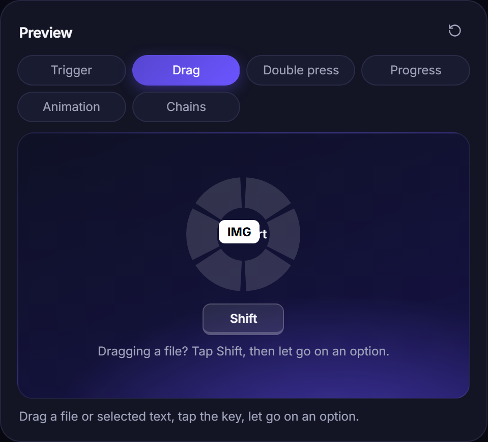</td>
<td width="50%">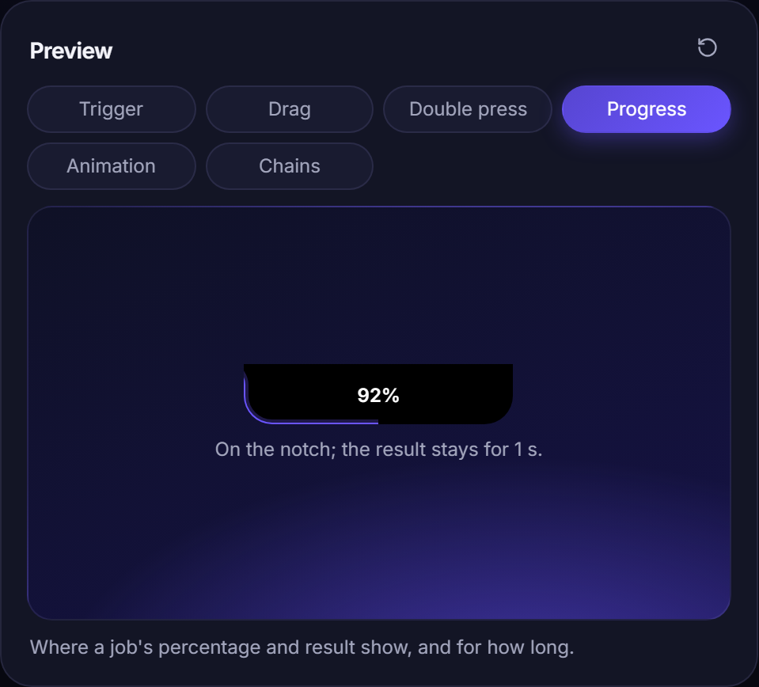</td>
</tr>
</table>

- **Convert.** PNG, JPG, WebP, BMP, GIF, TIFF, ICO, PDF. One PDF per image, or
  one PDF for all of them. Word and PowerPoint to PDF.
- **Tools.** Merge PDFs (images become pages), split a PDF by page ranges
  (`1-5, 6-20`), rotate, flip, grayscale, resize, compress, extract a ZIP.
- **Actions.** To the shelf, copy path or name, copy or move to a folder, zip,
  open a terminal there, set as wallpaper.

Shift switches between the three. Progress shows at the pointer or in the
notch, with a percentage. Esc cancels and leaves nothing half-written, and a
result never overwrites a file. Design your own menu: reorder, hide and preview
every option. Chain several options into one move.

Inspired by [OrbitDrop](https://github.com/i3sam/OrbitDrop).

### Settings and first run

One searchable place for everything, with no dropdowns (segments and steppers
instead), live previews, a "Reset this page" on every page, light and dark
themes, accent colours with a hex picker, and a full export and import of your
setup. It works fully by keyboard.

<table>
<tr>
<td width="50%">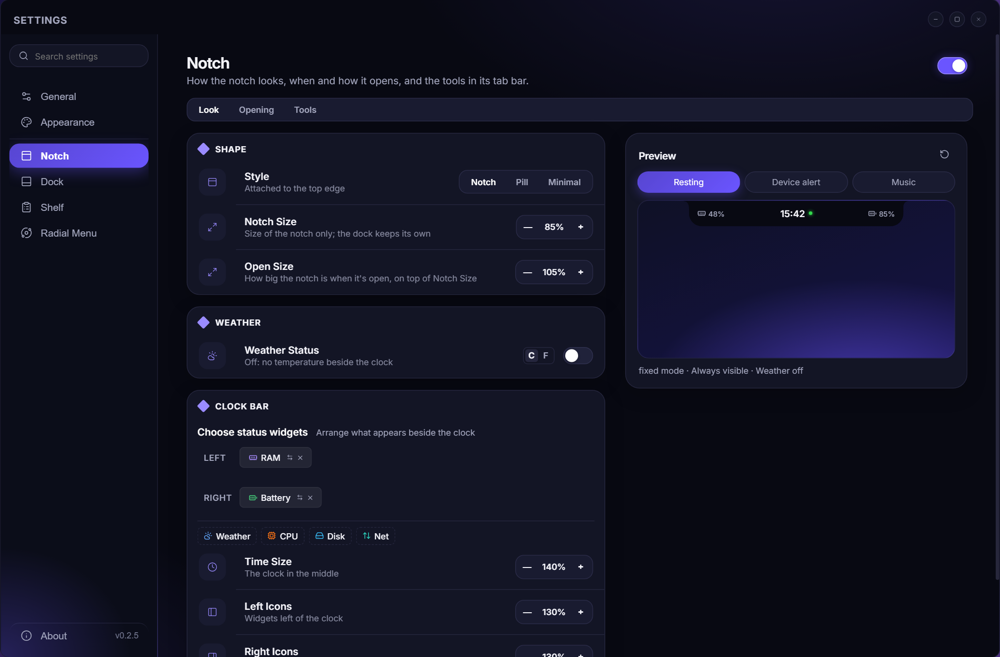</td>
<td width="50%">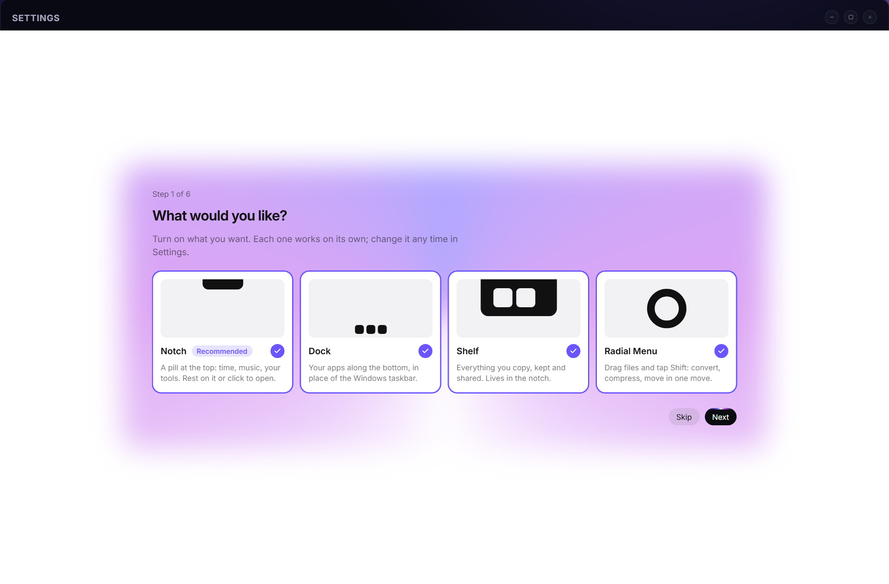</td>
</tr>
<tr>
<td align="center"><b>Every setting has a live preview.</b></td>
<td align="center"><b>First run:</b> pick the modules you want, size the notch and the dock on the real thing, choose your tools.</td>
</tr>
</table>

<details>
<summary><b>More Settings screenshots</b></summary>
<br />
<table>
<tr>
<td width="50%">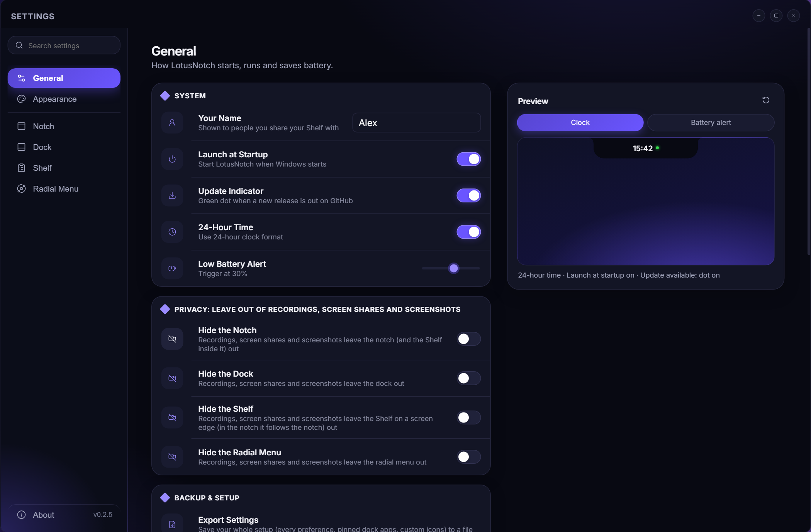</td>
<td width="50%">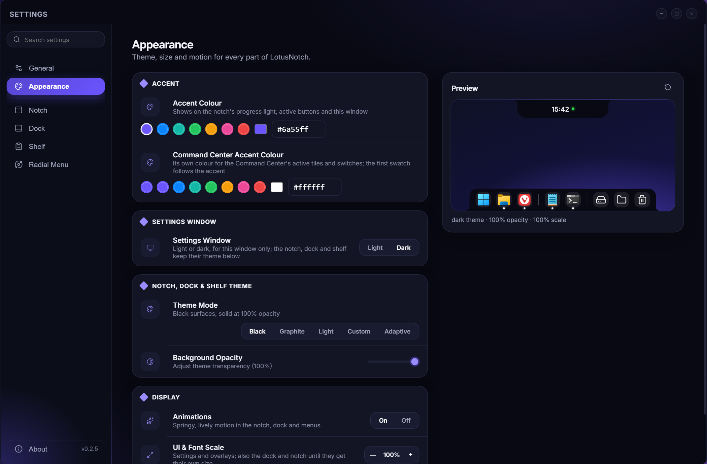</td>
</tr>
<tr>
<td width="50%">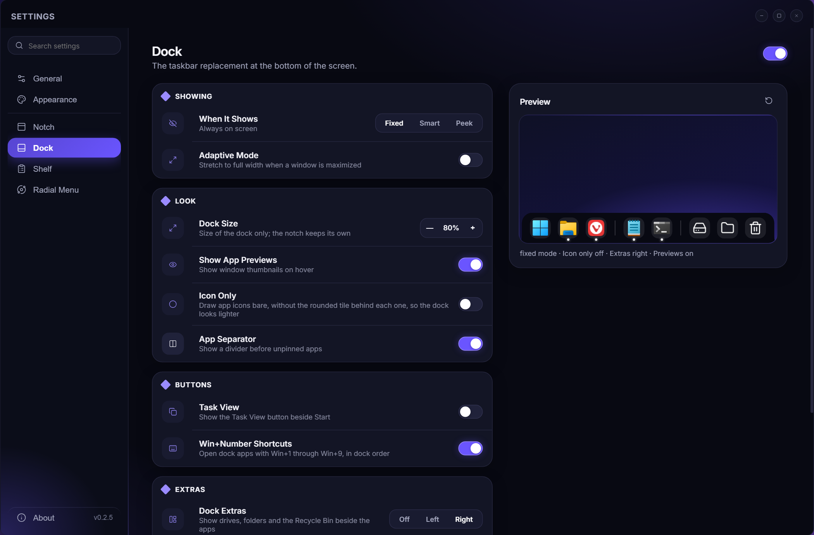</td>
<td width="50%">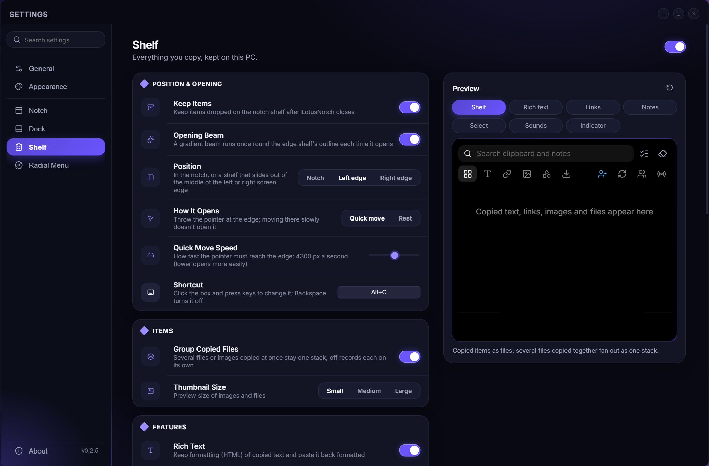</td>
</tr>
<tr>
<td colspan="2">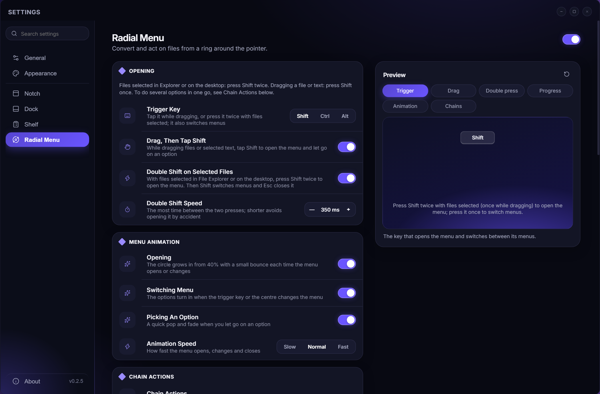</td>
</tr>
</table>
</details>

---

## Light on your PC

LotusNotch is built to cost you as little as possible, and it is honest about
where it stands.

| | |
| --- | --- |
| **Installer** | about 8 MB |
| **Idle memory** | about 250 MB for the whole process tree (private working set, Windows 11, measured on the author's PC, 2026-11-23). That is roughly half of what the app used before this round of work (about 480 MB). |
| **Goal** | under 100 MB idle. We are not there yet: [help wanted](#help-wanted-ram-and-uiux). |
| **Idle CPU** | background work sleeps when a module is off, when the notch is hidden, and (optionally) on battery. |

What already keeps it small:

- A Rust backend that talks straight to the Windows shell.
- Tools, Settings, the radial menu and the edge shelf load only when you use
  them and free their memory after. Prefer instant over light? Turn on **Keep
  Windows Loaded**.
- WebView2 runs its GPU work inside the app process (about 200 MB less), and
  **Low memory mode** is on by default.
- Modules you turn off stop their work completely.
- Animations are short and mostly transform and opacity, so they stay cheap.

---

## Install

**Download** the installer from
[Releases](https://github.com/IAMUCN/bloom-enhanced/releases/latest) and run
it. Needs Windows 10 or 11 (the WebView2 runtime, already part of Windows 11).

- **SmartScreen.** The installer is not code-signed with a paid certificate
  yet, so Windows may say "unknown publisher": choose *More info*, then *Run
  anyway*. Updates are signed and checked by the app itself.
- **Sharing.** The installer offers to add a Windows Firewall exception so
  nearby PCs can find this one. It is optional, and you can add it later from
  the Shelf's sharing page.
- **Updates.** LotusNotch tells you with a small dot when a new release is out,
  and updates from inside the app.
- **Uninstall.** From Windows Settings. It restores your taskbar and removes the
  firewall rule it added.

Opening LotusNotch from the Start menu opens its Settings.

---

## Help wanted: RAM and UI/UX

LotusNotch is a one-person project and it can get much better with more eyes.
If you like making desktop software lean or beautiful, **please open an issue
or a pull request.** Even a measurement or a screenshot helps.

### 1. Cut the memory use further (the big one)

Most of the memory is not our code. It is WebView2 (Edge) pages: one per
window, plus a browser and GPU process. Ideas we would love help with:

- Fewer renderer processes: the notch, dock, shelf and radial menu are separate
  windows today. Could some share a page, or be created only when they are
  needed (for example, no dock window at all while the Dock is off)?
- Trim what each page loads: split bundles by tool, lazy-load fonts and icons,
  drop dead CSS and JavaScript.
- Park hidden pages harder (WebView2 memory-target levels, suspending, freeing
  caches) without making them slow to come back.
- A repeatable benchmark: one script that launches the app, runs a fixed
  scenario and prints private working set, so every change has a number.
- Anything you know about Tauri and WebView2 that we do not.

When you report a number, please say how you measured it: Task Manager's
private working set of the whole process tree is what we use.

### 2. Make it feel better

- **Accessibility:** screen reader labels, focus order, contrast in every
  theme, reduced-motion behaviour.
- **Motion on weaker machines:** the notch opening and closing should stay
  smooth on an integrated GPU. A black box racing ahead of the notch was seen
  on one slow laptop; if you can reproduce rough frames, tell us.
- **Design polish:** spacing, icons, empty states, the light theme, the Tools
  pages.
- **Onboarding and discoverability:** is it clear what each module does in the
  first minute?
- **Languages:** nothing is translated yet.
- **New small tools** that fit a notch (see the scope in
  [CONTRIBUTING.md](CONTRIBUTING.md)).

### How to help in five minutes

1. Try the latest [release](https://github.com/IAMUCN/bloom-enhanced/releases/latest).
2. Tell us what was confusing or slow, with a screenshot or a short recording.
3. Or pick something above and open an issue with the **performance** or
   **feature** form, saying what you plan to try. We will reply with scope
   before you spend a weekend on it.

Not a programmer? A clear bug report, a design critique or a measurement from
your own PC is just as useful.

---

## Build from source

You need Windows 10 or 11, [Bun](https://bun.sh/) 1.4 or newer,
[Rust](https://rustup.rs/) (stable) and the Visual Studio C++ build tools.

```bash
git clone https://github.com/IAMUCN/bloom-enhanced.git
cd bloom-enhanced
bun install
bun run tauri dev      # full app with hot reload
```

Checks that CI runs (please run them before a pull request):

```bash
bun run build                          # typecheck + frontend build
bun test scripts/                      # frontend tests
cd src-tauri
cargo fmt --check
cargo clippy --locked --all-targets
cargo test --locked
```

Making a release is `bun run release <x.y.z>` from `main`; the steps are in
[RELEASE_CHECKLIST.md](RELEASE_CHECKLIST.md).

### How it's built

| Part | What |
| --- | --- |
| Shell | [Tauri 2](https://tauri.app/) (Rust) with WebView2 |
| Core | Rust: window management, hooks, clipboard, sharing, file jobs (`src-tauri/src`) |
| UI | React 19 and TypeScript, built with Vite and Bun |
| Windows | `main` (notch), `dock`, `clipshelf` (edge shelf), `orbit` (radial menu), `settings`, and an `overlay` for splash and updates |
| Settings | one flat `settings.json`; every key is documented in [SETTINGS.md](SETTINGS.md) |
| Updates | signed releases on GitHub; the app reads `latest.json` |

[AGENTS.md](AGENTS.md) has the commands, architecture and gotchas in more
detail, and [CONTRIBUTING.md](CONTRIBUTING.md) the contribution rules.

---

## Credits

LotusNotch stands on the work of three open-source projects:

| Project | By | What it brings |
| --- | --- | --- |
| [Bloom](https://github.com/SehajveerSingh2005/bloom) | [Sehajveer Singh](https://github.com/SehajveerSingh2005) | The notch, dock, overlays and the app itself |
| [Edge-Drop](https://github.com/Deepender25/Edge-Drop) | [Deepender25](https://github.com/Deepender25) | The edge shelf for what you copy and drag |
| [OrbitDrop](https://github.com/i3sam/OrbitDrop) | [i3sam](https://github.com/i3sam) | The radial menu for files |

Their licenses and notices are in
[THIRD_PARTY_NOTICES.md](THIRD_PARTY_NOTICES.md).

## License

Licensed under [GPLv3](LICENSE), like Bloom.

---

<div align="center">

**LotusNotch** · made by [IAMUCN](https://github.com/IAMUCN)

A product of **UCN INDUSTRIES**

</div>
